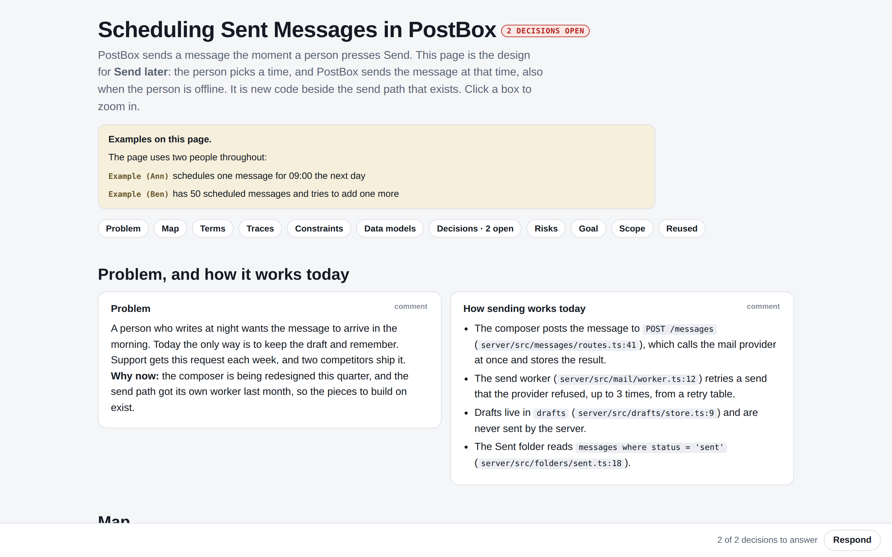
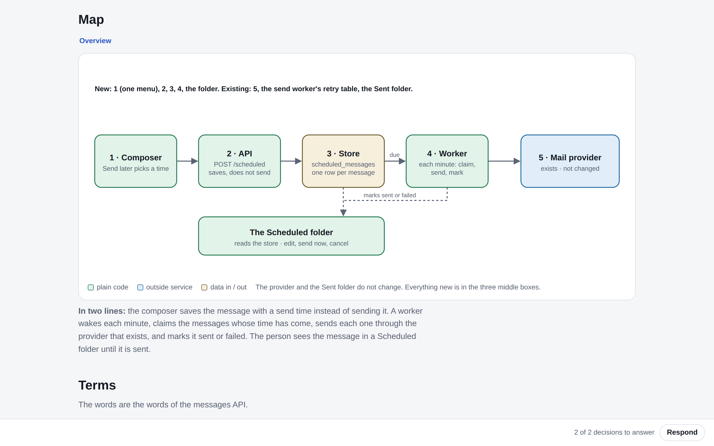

# visual-plan

**Stop reading 10-page plans. See the design on one page, answer the open decisions, lock it.**

`visual-plan` is an agent skill (Claude Code, Codex, and any agent that reads `SKILL.md`) that writes the
design for one change as **one interactive HTML page**, for the person who has to approve it:

- a **zoomable map** of the proposed design: click a box to zoom in (map → zoom → detail)
- the **decisions** that are actually yours, as clickable options on the part they change, with the agent's recommendation and nothing preselected
- a short problem/current state, a worked trace, constraints, goal, and scope
- plain words: the prose follows ASD-STE100 (Simplified Technical English) rules, and the pack lints them
- a **Respond** button that sends all your answers back in one message, and a **Lock**

It is the brief, not the plan. Tasks, files, and tests come after the lock, in a separate document.




## How it works

The agent writes one content file, `plan.yaml`. The pack lints it and composes it with the runtime into a
single self-contained `plan.html` (no network, no build step, only `node`):

```bash
node runtime/pack.mjs plan.yaml            # → plan.html
node runtime/pack.mjs plan.yaml --strict   # warnings fail the build
```

Try it on the bundled synthetic example:

```bash
node runtime/pack.mjs examples/example.yaml && open examples/example.html
```

## Install

**Claude Code**

```bash
git clone https://github.com/AlmogBaku/visual-plan ~/.claude/skills/visual-plan
```

Then ask for it: `/visual-plan`, "make a visual plan for …".

**Codex / other agents:** clone the repository wherever your agent loads skills from; the entry point is
`SKILL.md`.

## What's inside

```
SKILL.md                      the skill: what the page is and is not, sections, node tree, words
references/sections.md        the section contract
references/words.md           writing rules (STE) and badge vocabulary
references/nodes.md           the node tree: views, depth, the Respond sheet
runtime/                      visualplan.css + visualplan.js, pack.mjs (lint + compose)
examples/                     example.yaml → example.html
```

## License

Apache License 2.0. See [LICENSE](LICENSE) and [NOTICE](NOTICE). Bundles js-yaml (MIT).

Made by [@AlmogBaku](https://github.com/AlmogBaku). Built for the talk *"FML. My Plan Slopped to 10 Pages: Visual Plans to the Rescue."*
